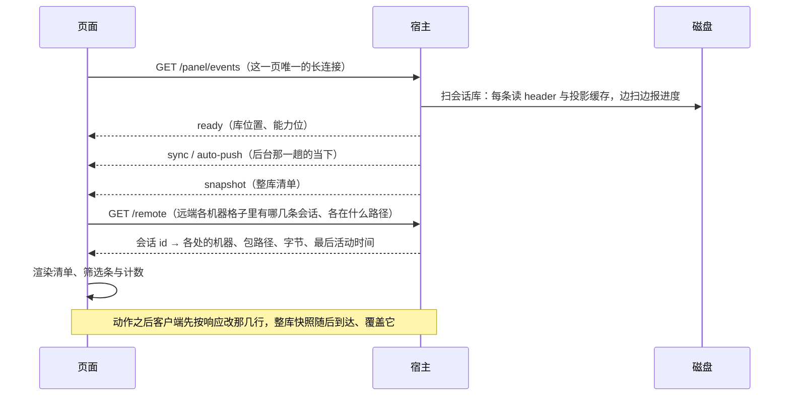
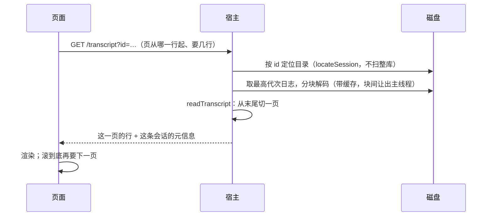
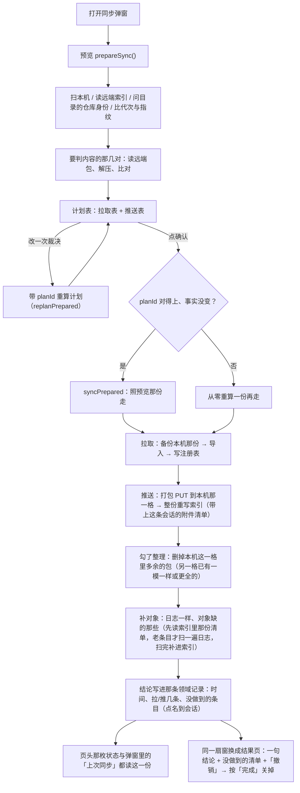
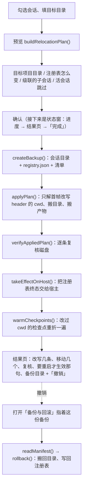
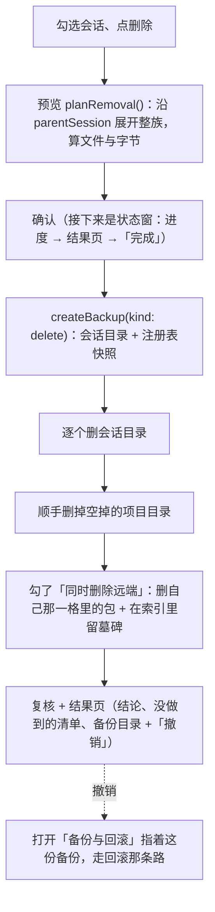
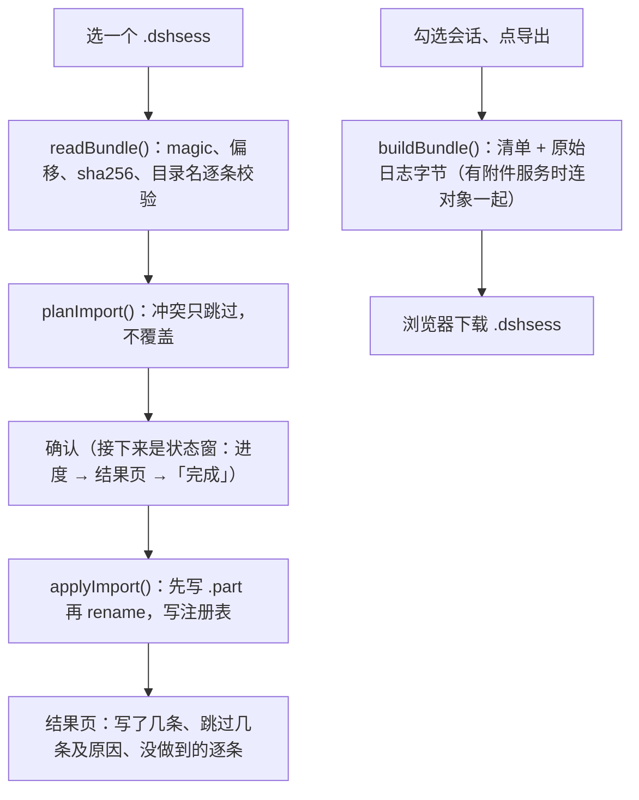
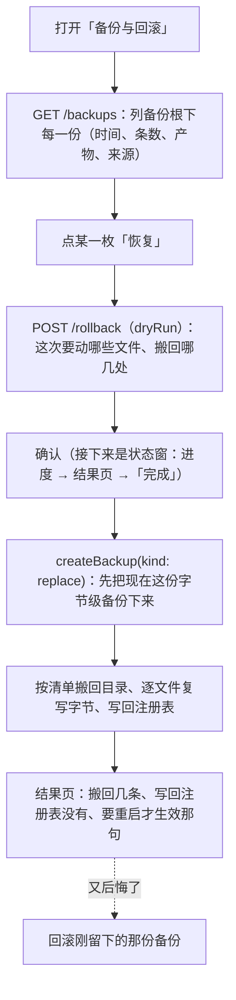
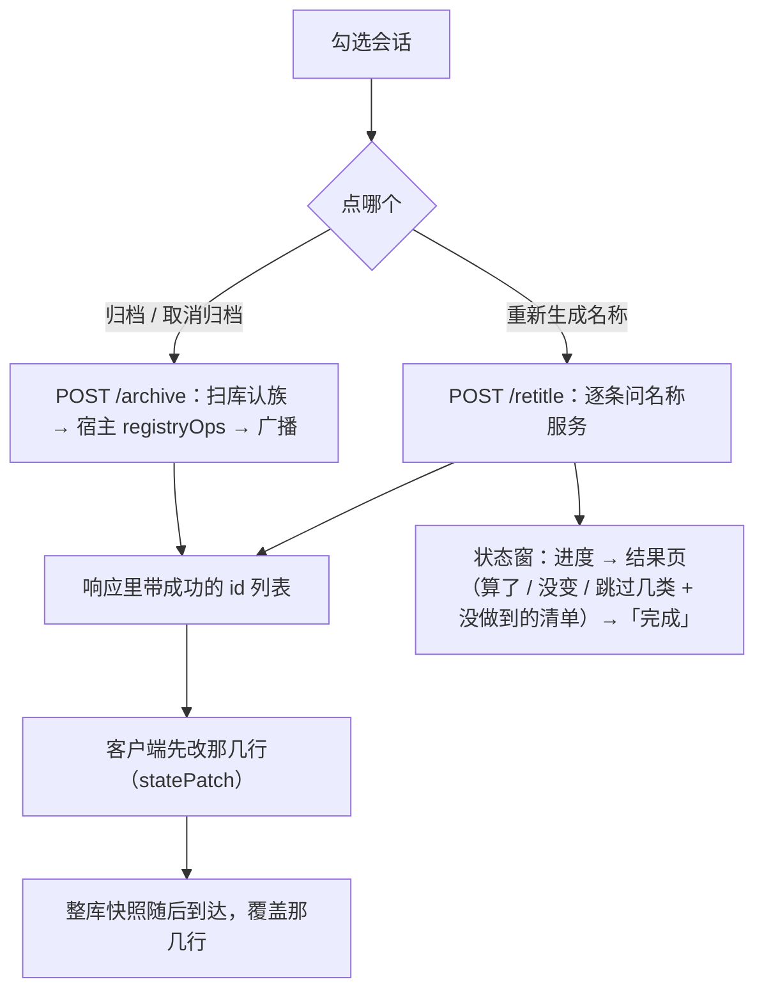
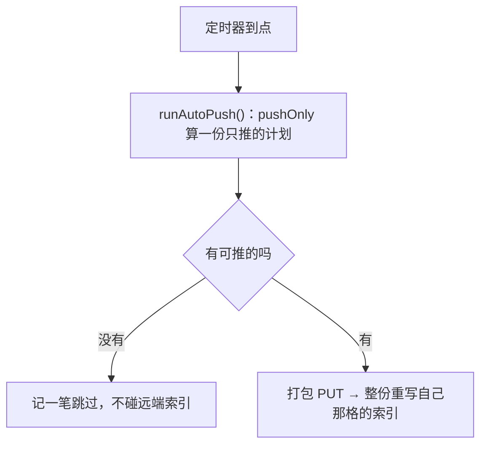
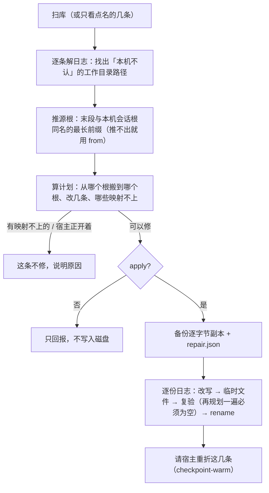

# 各种操作的流程

每张图都从「界面上的那一下」开始，到「磁盘或远端变成什么样」结束。字段与校验的细节在
[formats.md](formats.md)，界面与样式的规格在 [design.md](design.md)，**为什么**这么设计在
[.agents/notes](../.agents/notes/AGENTS.md) 里。

**七条会写入磁盘或耗时的流程（同步、迁移、删除、导入、回滚、整理远端、重算名称）都是同一条界面线**：
确认弹窗（看计划 / 账目）→ 状态窗（进度 +「转到后台」）→ 同一个窗口换成结果页（一句结论 + 可选的
「没做到 N 条」+「撤销」）→ 底栏「完成」关掉回页面。执行中点「转到后台」只是把窗口收起来：活儿在
宿主那边继续跑，进度与结论改在底部状态栏那一格报，点它回到同一扇窗。各节只写"到这一步为止做了什么
读写"，界面那一层不再重复。

这条线带来一个边界，写在最前面：**进度与结果只存在于浏览器内存里**。刷新整个页面，这一份就没了
（宿主那边照旧把这一趟跑完）；后台同步是唯一例外，它那一趟能从 `GET /panel/events` 认领回来，但只剩
"跑没跑、搬了几条"。写入磁盘的只有各自的记录（同步的那条领域记录、备份清单），它们说的是上一次的结果。

## 一、打开「会话管理」：清单只有一条来路

读：`<会话根>/<projectKey>/<id>/session.vN.jsonl.zstd` 的 header、宿主投影缓存里那两件事（空白、最后
活动时间）。写：什么都不写。清单一变就整页重画，所以「刷新」与「动作之后」走的是同一条连接、同一份
数据。

`GET /remote` 是另一条一次性的读（不在那条长连接上）：它问的是**远端**，一次读齐每台机器那份
`index.json`，整份留在页面这一层，右栏那行「远端」翻来翻去只是查表——清单每换一份读一次，一次同步
应用之后再读一次。远端读不到不影响本机清单：那一条失败只在右栏那一格里说一句（见
[决策](../.agents/notes/implemented/architecture/2026-11-15-remote-placement-read-once-per-refresh.md)）。

## 二、看一条会话的内容

只读。`from` 是"从末尾往前第几行"，所以翻页只要重算窗口，不必从头解一遍（日志按行切分后有缓存）。

## 三、同步

读：本机会话库、各机器格的 `index.json`、需要判内容时的远端包。写：自己那一格的包与 `index.json`、
拉取应用的会话目录与注册表、共享对象库里缺的对象。预览不写任何东西；应用前 `syncPrepared()` 先验
「本机与远端还是不是预览那样」，变了就从零重算。

补对象那一步以前每次手动同步都把本机日志整库解压一遍（1.2 GB 实测 144 秒、主线程不让出）；现在按
索引里那份附件清单走，只有老条目（清单缺席）才扫一次、扫完写回索引；扫描本身分块解压、块间让出，
并且逐条报 `attachScan` 进度。同一份文件的结果还会按 `size + mtime` 缓存，缓存没变就不再解。

「整理远端」只碰自己那一格：另一格有一模一样或更全的副本时，把自己这格多出来的包删掉（判据是内容
与格子名，两台机器算出来是同一份，不会互相删）。预览里只报"能删几个"，勾了才在应用那次真删。

跑完之后那份结论落在官方领域存储里（`<storages>/session_manager.json` 的 `sync_runs.last`，见
[formats.md](formats.md)）：时间、拉推条数、以及**没做到的条目**——每条会话一句（名字 + id + 原因），
不属于哪条会话的（映射、远端索引、整理那几步）是原话。
页头那枚状态的悬浮提示只报条数，弹窗里的「上次同步」列全，带 id 的那几条能一键把列表筛到它
（见 [sync-leftovers 那篇](../.agents/notes/implemented/bug-fix/2026-11-13-sync-leftovers-are-pointed.md)）。

界面这一侧跑完不回面板：这一趟改成**结果页**（标题「同步完成」）——一句结论（拉了几条、推了几条，
再加"另有…"那几项）、没做到的逐条、覆盖或跟着删过本机内容时那句"旧的那份在「备份与回滚」里"与
那枚「撤销」。底栏只剩「完成」，按它把结论收掉。原先那条绿色提示横幅、按钮「知道了」、以及
"后台同步结束：…"那一句都不再说了：同一件事在三个地方各说一遍，读的人还得自己挑信哪个。

「整理远端」也能单独跑（不必先跑一趟完整同步）：`GET /sync?mode=tidy` 只读远端、算账，`POST` 同一个
地址才删——先重写自己那一格的 `index.json`（去掉要删的条目），再逐个删包，最后清掉没有索引条目的包。
不扫本机库、不拉不推、不动注册表。它自己走那条四段线（确认 → 状态窗 → 结果页 →「完成」），只是账目
里没有拉取与推送那几张表。

## 四、迁移

读：目标与来源的项目目录、注册表、每条会话的代次日志。写：备份目录、日志首行 header 的 `cwd`、
会话目录、注册表、宿主的投影缓存（重折一遍）。预览与执行走同一个 `buildRelocationPlan()`，界面看到的
计划就是执行时会做的事；回滚只依据备份清单，不认识计划。

## 五、删除

注册表**一个字节都不动**：宿主本来就把「登记了但日志不在」当正常状态，恢复时那条会话的登记与归档
状态也就自动回到原样。删除没有别的副本，所以备份必须成功才动手。

远端那一步只删**自己那一格**（别的机器的格子归它们自己）：包删掉的同时在索引里留一条删除记录
（墓碑）。不留的话，下一次同步会把这条会话当「远端有、本机没有」重新拉回来——这正是普通删除最容易被
忽略的后果。别的机器下次同步看到墓碑，会把自己那份（比墓碑旧的）删掉；删远端没有备份，失败不拦本机
删除，但会在问题清单里写明「下次同步可能把它拉回来」。

## 六、导入与导出

导入只跳过、不覆盖；覆盖本机那份只发生在同步的拉取路径上，那条路会先备份。导出是纯读：日志按磁盘
上的原始字节进包，不重新编码。

应用时每条日志改写两处：header 的 `cwd` 换成本机路径，以及 `working-directory/change` 里那些
**本机不认的**路径（另一台机器、另一种系统的写法）跟着会话根一起搬。不搬第二处的话，这条会话在本机
会打不开——宿主拿那个值当当前工作目录并要求本机绝对路径，投影失败会让整条会话读不出来（见
[决策](../.agents/notes/implemented/bug-fix/2026-11-13-imported-working-directory-paths.md)）。

## 七、回滚（备份与回滚）

读：备份清单与清单里的文件、当前库与注册表。写：备份自己这份、会话目录与日志字节、注册表。回滚只
认备份清单（`manifest.json`），不认识当初是哪条流程留下的——所以删除、迁移、同步覆盖三种备份都能用
同一条路退回去。回滚之前先把"现在这份"也备份下来：回滚本身也会改盘，它同样要有后悔面。

删除 / 迁移 / 同步的结果页上那枚「撤销」就是这条路：它不直接回滚，只打开这一面并指着刚留下的那份
备份，回不回、回哪一份由用户看过清单再决定。

## 八、归档与重算名称

两个都是"宿主自己的能力，插件只转发"：归档落注册表，重算名称落日志里的事件。响应已经说清改了哪
几条，所以界面不必等整库快照（那张快照要 0.9～1.1 秒）。

归档与导出是"按下去就做完"的那一类：它们在动作行下面报进度、结果落页面那条提示，不经过状态窗。
重算名称不一样——它逐条问名称服务，可能几十秒，也可能"算了 3 条、跳过 5 条（其中 4 条你改过名）"，
所以它走那条四段线，跳过原因与失败清单都在结果页上。

## 九、后台自动推送

同一套计划层与包格式，只是没有预览与确认那一步；结论挂在面板流上，关掉设置窗口再回来还看得见。

## 十、修日志里的路径

已经应用的会话改不了"应用那一刻"，所以这条路单独修：工具 `repair_session_paths`（默认只预览）。

预览要把整条会话解一遍才知道有没有要修的值，所以扫全库是这条路上最贵的一步：能点名就点名。修完
之后这条会话的对话页就能打开了，列表里那行元数据也会顺手补上。
