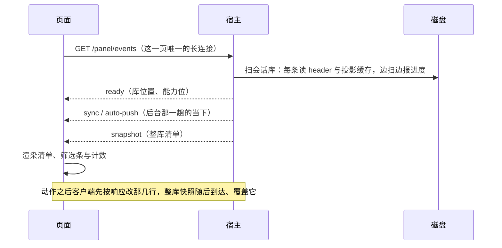
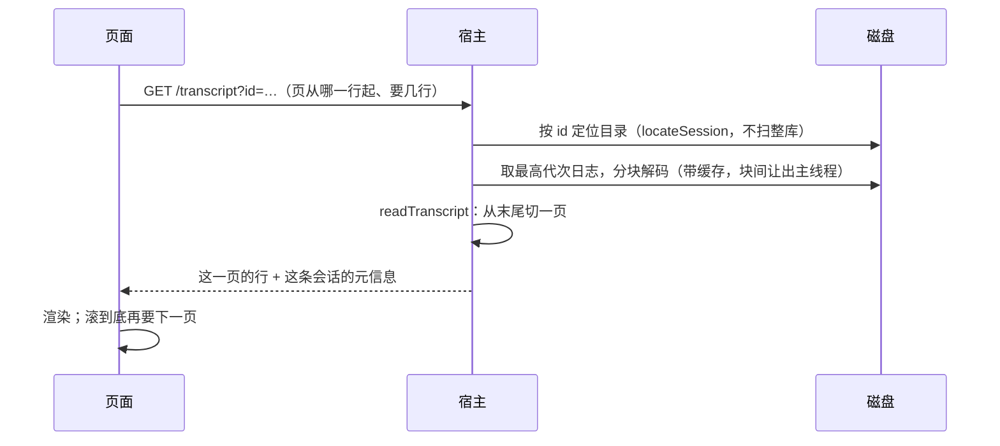
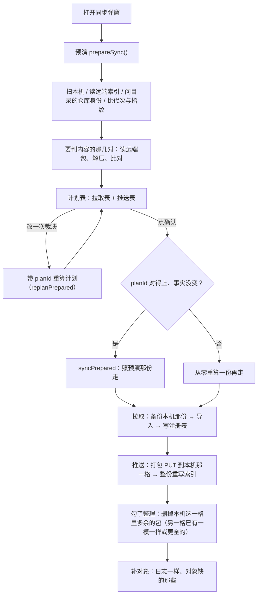
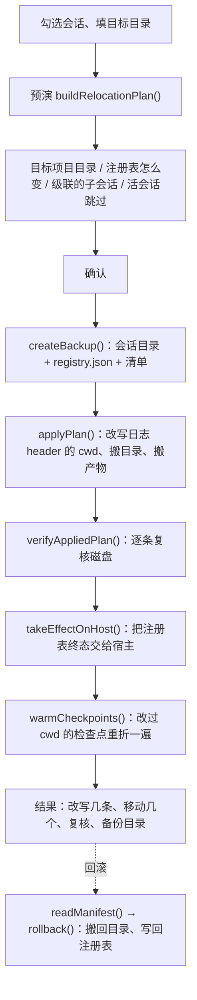
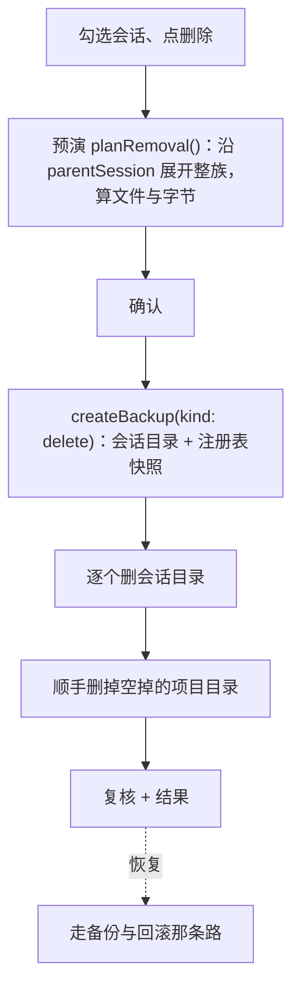
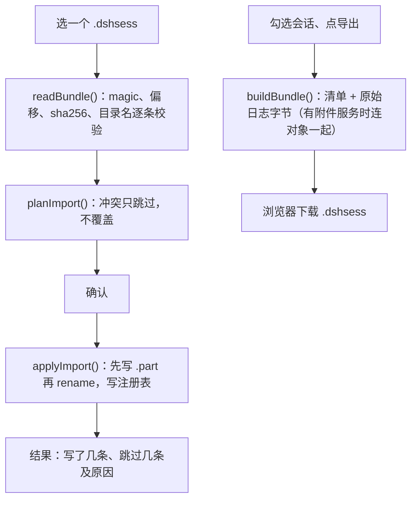
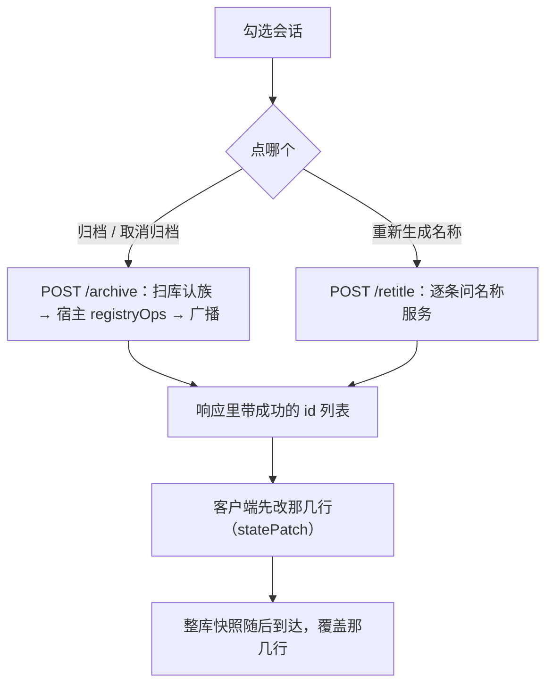
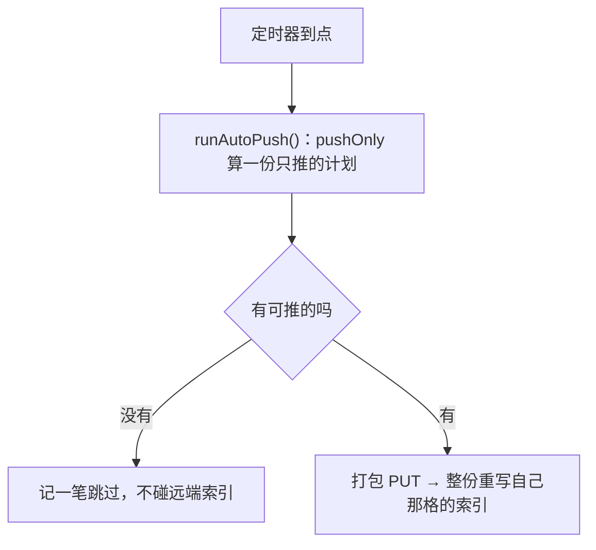
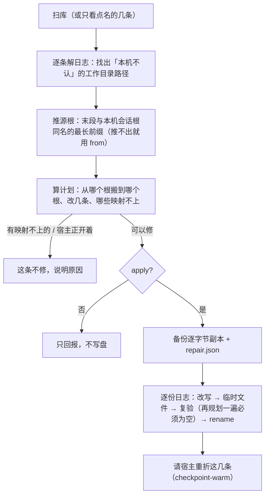

# 各种操作的流程

每张图都从「界面上的那一下」开始，到「磁盘或远端变成什么样」结束。字段与校验的细节在
[formats.md](formats.md)，界面与样式的规格在 [design.md](design.md)，**为什么**这么设计在
[.agents/notes](../.agents/notes/AGENTS.md) 里。

## 一、打开「会话管理」：清单只有一条来路

读：`<会话根>/<projectKey>/<id>/session.vN.jsonl.zstd` 的 header、宿主投影缓存里那两件事（空白、最后
活动时间）。写：什么都不写。清单一变就整页重画，所以「刷新」与「动作之后」走的是同一条连接、同一份
数据。

## 二、看一条会话的内容

只读。`from` 是"从末尾往前第几行"，所以翻页只要重算窗口，不必从头解一遍（日志按行切分后有缓存）。

## 三、同步

读：本机会话库、各机器格的 `index.json`、需要判内容时的远端包。写：自己那一格的包与 `index.json`、
拉取落地的会话目录与注册表、共享对象库里缺的对象。预演不写任何东西；落地前 `syncPrepared()` 先验
「本机与远端还是不是预演那样」，变了就从零重算。

「整理远端」只碰自己那一格：另一格有一模一样或更全的副本时，把自己这格多出来的包删掉（判据是内容
与格子名，两台机器算出来是同一份，不会互相删）。预演里只报"能删几个"，勾了才在落地那次真删。

它也能单独跑（不必先跑一趟完整同步）：`GET /sync?mode=tidy` 只读远端、算账，`POST` 同一个地址才删
——先重写自己那一格的 `index.json`（去掉要删的条目），再逐个删包，最后清掉没有索引条目的包。不扫本
机库、不拉不推、不动注册表。

## 四、迁移

读：目标与来源的项目目录、注册表、每条会话的代次日志。写：备份目录、日志首行 header 的 `cwd`、
会话目录、注册表、宿主的投影缓存（重折一遍）。预演与执行走同一个 `buildRelocationPlan()`，界面看到的
计划就是执行时会做的事；回滚只依据备份清单，不认识计划。

## 五、删除

注册表**一个字节都不动**：宿主本来就把「登记了但日志不在」当正常状态，恢复时那条会话的登记与归档
状态也就自动回到原样。删除没有别的副本，所以备份必须成功才动手。

## 六、导入与导出

导入只跳过、不覆盖；覆盖本机那份只发生在同步的拉取路径上，那条路会先备份。导出是纯读：日志按磁盘
上的原始字节进包，不重新编码。

落地时每条日志改写两处：header 的 `cwd` 换成本机路径，以及 `working-directory/change` 里那些
**本机不认的**路径（另一台机器、另一种系统的写法）跟着会话根一起搬。不搬第二处的话，这条会话在本机
会打不开——宿主拿那个值当当前工作目录并要求本机绝对路径，投影失败会让整条会话读不出来（见
[决策](../.agents/notes/implemented/bug-fix/2026-11-13-imported-working-directory-paths.md)）。

## 七、归档与重算名称

两个都是"宿主自己的能力，插件只转发"：归档落注册表，重算名称落日志里的事件。响应已经说清改了哪
几条，所以界面不必等整库快照（那张快照要 0.9～1.1 秒）。

## 八、后台自动推送

同一套计划层与包格式，只是没有预演与确认那一步；结论挂在面板流上，关掉设置窗口再回来还看得见。

## 九、修日志里的路径

已经落地的会话改不了"落地那一刻"，所以这条路单独修：工具 `repair_session_paths`（默认只预演）。

预演要把整条会话解一遍才知道有没有要修的值，所以扫全库是这条路上最贵的一步：能点名就点名。修完
之后这条会话的对话页就能打开了，列表里那行元数据也会顺手补上。
